# Modelo entidad-relación

Esquema normalizado (3FN) de la base `programatss`. La definición completa está en
[`db/schema.sql`](../db/schema.sql). `npm run db:init` crea las tablas y `npm run db:seed` carga los datos.

```mermaid
erDiagram
    %% ---------------- Encuestas ----------------
    titulados {
        int id PK
        text edad "CHECK catálogo"
        text genero "CHECK catálogo"
        text formacion_complementaria "Sí / No"
        smallint nivel_realizado_id FK
        smallint lugar_realizado_id FK
        smallint financiamiento_id FK
        text programa
        text interes_posgrado "Sí / No"
        smallint area_interes_id FK
        smallint institucion_preferida_id FK
        smallint opinion_posgrado_fcyt_id FK
        float8 anios_vida_profesional "0 a 60"
        float8 anios_desempleado "0 a 60, <= vida profesional"
        text situacion_laboral "CHECK catálogo"
        text empresa
        smallint rubro_id FK
        smallint sector_id FK
        text departamento "CHECK catálogo"
        smallint cargo_id FK
        smallint pertinencia_labores_id FK
        text antiguedad_trabajo "CHECK catálogo"
        text medio_obtencion "CHECK catálogo"
        text remuneracion "CHECK catálogo"
        text origen_emprendimiento "CHECK catálogo"
        text entregable_negocio "CHECK catálogo"
        smallint financiamiento_negocio_id FK
        text satisfaccion_negocio "CHECK catálogo"
        text importancia_formacion_negocio "CHECK catálogo"
        text primer_empleo "Sí / No"
        text razon_no_trabaja "CHECK catálogo"
        text trabajo_previo_sistemas "Sí / No"
        text tiempo_primer_empleo "CHECK catálogo"
        text numero_empleos "CHECK catálogo"
        smallint satisfaccion_global_id FK
        smallint concordancia_formacion_id FK
        text red_contactos "Sí / No"
        text origen "base_oficial | formulario"
        timestamptz created_at
    }

    empleadores {
        int id PK
        text organizacion "al menos 2 caracteres"
        smallint tipo_id FK "sector: Privado / Público"
        text tamano "CHECK catálogo"
        smallint rubro_id FK
        text contrato_5_anios "Sí / No"
        text posibilidad_contratacion "CHECK catálogo"
        text nivel_demandado "CHECK catálogo"
        text medio_convocatoria "CHECK catálogo"
        text tendencias
        text habilidades
        text origen "base_oficial | formulario"
        timestamptz created_at
    }

    items_empleadores {
        int id PK
        text codigo UK "item_01 … item_18"
        text afirmacion
        text origen
        timestamptz created_at
    }

    respuestas_empleador {
        int empleador_id PK, FK
        int item_id PK, FK
        smallint valor_id FK
    }

    %% ---------------- Selección múltiple ----------------
    titulado_actividad {
        int titulado_id PK, FK
        smallint actividad_id PK, FK
        smallint orden "posición en la respuesta"
    }
    titulado_aspecto_util {
        int titulado_id PK, FK
        smallint aspecto_id PK, FK
        smallint orden
    }
    titulado_aspecto_mejorar {
        int titulado_id PK, FK
        smallint aspecto_id PK, FK
        smallint orden
    }
    titulado_asignatura_ventaja {
        int titulado_id PK, FK
        smallint asignatura_id PK, FK
        smallint orden
    }
    titulado_asignatura_no_util {
        int titulado_id PK, FK
        smallint asignatura_id PK, FK
        smallint orden
    }
    empleador_cargo {
        int empleador_id PK, FK
        smallint cargo_id PK, FK
        smallint orden
    }

    %% ---------------- Catálogos (id, nombre único) ----------------
    areas_posgrado {
        smallint id PK
        text nombre UK
    }
    instituciones {
        smallint id PK
        text nombre UK
    }
    niveles_posgrado {
        smallint id PK
        text nombre UK
    }
    fuentes_financiamiento {
        smallint id PK
        text nombre UK
    }
    rubros {
        smallint id PK
        text nombre UK
    }
    sectores {
        smallint id PK
        text nombre UK
    }
    cargos_titulado {
        smallint id PK
        text nombre UK
    }
    cargos_empleador {
        smallint id PK
        text nombre UK
    }
    asignaturas {
        smallint id PK
        text nombre UK
    }
    aspectos_carrera {
        smallint id PK
        text nombre UK
    }
    actividades {
        smallint id PK
        text nombre UK
    }
    escala_likert_titulado {
        smallint id PK "= valor 1 a 4"
        text nombre UK
    }
    escala_likert_empleador {
        smallint id PK
        text codigo UK "TA, PA, TD, NS"
        text nombre UK
    }

    %% ---------------- Relaciones ----------------
    niveles_posgrado       |o--o{ titulados : "nivel_realizado_id"
    instituciones          |o--o{ titulados : "lugar_realizado_id"
    instituciones          |o--o{ titulados : "institucion_preferida_id"
    fuentes_financiamiento |o--o{ titulados : "financiamiento_id"
    fuentes_financiamiento |o--o{ titulados : "financiamiento_negocio_id"
    areas_posgrado         |o--o{ titulados : "area_interes_id"
    rubros                 |o--o{ titulados : "rubro_id"
    sectores               |o--o{ titulados : "sector_id"
    cargos_titulado        |o--o{ titulados : "cargo_id"
    escala_likert_titulado |o--o{ titulados : "4 preguntas Likert"

    sectores ||--o{ empleadores : "tipo_id"
    rubros   |o--o{ empleadores : "rubro_id"

    empleadores             ||--o{ respuestas_empleador : "responde"
    items_empleadores       ||--o{ respuestas_empleador : "afirmación"
    escala_likert_empleador ||--o{ respuestas_empleador : "valor"

    titulados        ||--o{ titulado_actividad : "elige"
    actividades      ||--o{ titulado_actividad : "opción"
    titulados        ||--o{ titulado_aspecto_util : "elige"
    aspectos_carrera ||--o{ titulado_aspecto_util : "opción"
    titulados        ||--o{ titulado_aspecto_mejorar : "elige"
    aspectos_carrera ||--o{ titulado_aspecto_mejorar : "opción"
    titulados        ||--o{ titulado_asignatura_ventaja : "elige"
    asignaturas      ||--o{ titulado_asignatura_ventaja : "opción"
    titulados        ||--o{ titulado_asignatura_no_util : "elige"
    asignaturas      ||--o{ titulado_asignatura_no_util : "opción"
    empleadores      ||--o{ empleador_cargo : "elige"
    cargos_empleador ||--o{ empleador_cargo : "opción"
```

## Tablas

| Grupo | Tablas | Contenido |
|---|---|---|
| Encuestas | `titulados`, `empleadores` | Una fila por encuesta. `origen` distingue la base oficial de las encuestas cargadas desde los formularios. |
| Afirmaciones | `items_empleadores`, `respuestas_empleador` | Las 18 afirmaciones y la respuesta de cada empleador a cada una (PK `empleador_id, item_id`). Una afirmación sin respuesta no tiene fila. |
| Selección múltiple | `titulado_actividad`, `titulado_aspecto_util`, `titulado_aspecto_mejorar`, `titulado_asignatura_ventaja`, `titulado_asignatura_no_util`, `empleador_cargo` | Una fila por opción elegida. `orden` conserva el orden de la respuesta original. |
| Catálogos | `areas_posgrado`, `instituciones`, `niveles_posgrado`, `fuentes_financiamiento`, `rubros`, `sectores`, `cargos_titulado`, `cargos_empleador`, `asignaturas`, `aspectos_carrera`, `actividades` | `(id, nombre único)`. Se cargan desde `src/data/catalogos.ts`. |
| Escalas | `escala_likert_titulado`, `escala_likert_empleador` | En la escala de titulados el `id` es el propio valor (1 a 4); la de empleadores tiene además un código (`TA`, `PA`, `TD`, `NS`). |

## Vistas

`v_titulados` y `v_empleadores` devuelven el formato plano que usan la API, el frontend y los
análisis: los mismos nombres de columna que la base oficial y el importador, los textos de los
catálogos en lugar de ids, las selecciones múltiples como arreglos (en su orden original) y las
respuestas de empleadores como columnas `item_01` … `item_18`.

## Decisiones de normalización

- **Sin grupos repetidos (1FN).** Las columnas de tipo arreglo y las columnas `item_01` … `item_18`
  pasaron a las tablas intermedias y a `respuestas_empleador`.
- **Sin dependencias parciales (2FN).** Las tablas con PK compuesta solo guardan datos de la
  relación (`orden`, `valor_id`).
- **Sin dependencias transitivas (3FN).** Los textos de las opciones viven una sola vez en su
  catálogo. `empresa`, `rubro` y `sector` son respuestas independientes de cada titulado (dos
  personas pueden clasificar la misma empresa de forma distinta), así que no hay una dependencia
  `empresa → rubro`.
- **Catálogos compartidos.** `rubros`, `instituciones`, `fuentes_financiamiento`, `asignaturas` y
  `aspectos_carrera` reúnen las opciones de dos preguntas, y `sectores` sirve también como tipo de
  organización del empleador. Qué subconjunto acepta cada pregunta lo valida la API con
  `src/utils/validacion.ts`.
- **Opciones sin tabla de catálogo.** Las demás preguntas de opción (edad, género, Sí/No,
  remuneración, etc.) se guardan como texto con un `CHECK (columna IN (…))`. La prueba
  `server/esquema.test.ts` comprueba que esas listas coincidan con `src/data/catalogos.ts`.

## Restricciones e índices

- `anios_desempleado <= anios_vida_profesional`, y ambos entre 0 y 60.
- Preguntas condicionales: datos del posgrado solo si lo cursó, datos del empleo solo si trabaja,
  razón de no trabajar solo si no trabaja y datos del negocio solo si emprende.
- Borrar un titulado o un empleador borra en cascada sus selecciones y respuestas. Una opción de
  catálogo que está en uso no se puede borrar.
- Todas las claves foráneas tienen índice. La primera columna de cada PK compuesta ya queda
  indexada por la propia PK.

## Migración desde el esquema anterior

Si `npm run db:init` encuentra las tablas sin normalizar (titulados con arreglos, empleadores con
`item_01` … `item_18`), las mueve al esquema `legacy` y crea las nuevas. Después, `npm run db:seed`
carga los catálogos y la base oficial, migra las encuestas de formularios conservando su `id` y
su `created_at`, y elimina `legacy`.
